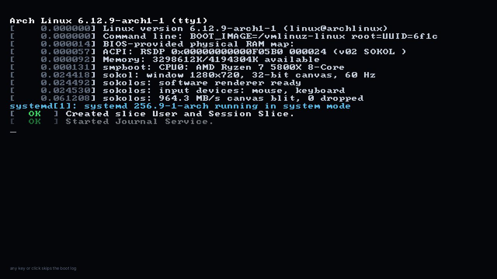
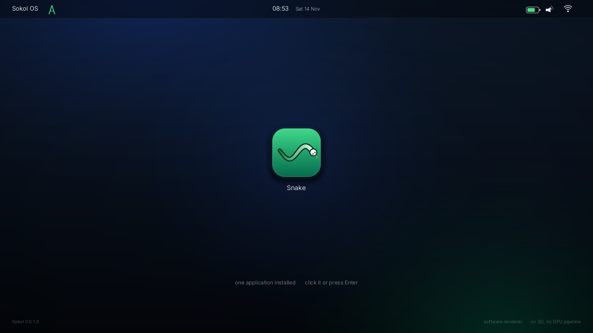
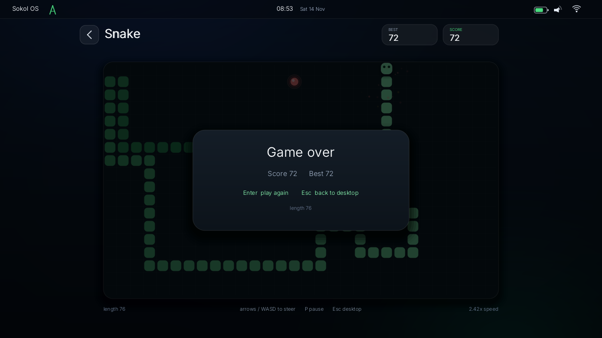

# Sokol OS

**Одна программа на C, одно окно, одна игра.** Sokol OS стартует как
настоящий Arch Linux: ядро печатает dmesg, systemd выводит зелёные
`[  OK  ]`, затем появляется приглашение `archlinux login:` и командная
строка, которая сама набирает `snake --desktop`. После этого экран
превращается в рабочий стол с часами, строкой состояния и **единственной**
иконкой — змейкой.

Вся графика — это `sokol` (окно, ввод, вывод пикселей) и собственная
программная растеризация на CPU. Внутри нет ни одного треугольника, кроме
двух, из которых склеен прямоугольник на весь экран.

```
./build.sh run          # собрать и запустить
./build.sh frames       # отрисовать скриншоты без окна -> build/frames
```





## Что здесь есть

| Экран | Что происходит |
| --- | --- |
| **Загрузка** | консоль Arch Linux: строки `dmesg`, `systemd[1]`, `[  OK  ]`, курсор, затем логин `root`, скрытый пароль и `snake --desktop`. Любая клавиша или клик пропускает загрузку. |
| **Рабочий стол** | обои с плавным свечением, верхняя панель с живыми часами и иконками Wi-Fi/звука/батареи, одна иконка приложения по центру, подписи и подсказки. |
| **Змейка** | поле 30×18, еда, ускорение с каждым яблоком, счёт и рекорд, пауза, экран «Game over», возврат на рабочий стол по `Esc` или кнопке «назад». |

Управление: мышь — всё, клавиатура — `Enter` открыть приложение,
стрелки/WASD — руль, `P` — пауза, `R`/`Enter` — заново, `Esc` — назад
(на рабочем столе `Esc` закрывает приложение).

## Никакого 3D

Просьба «убрать 3D из sokol и OpenGL» выполнена буквально:

* **нет** буфера глубины, трафарета, MSAA, матриц, проекций, камеры и
  геометрии — в `sapp_desc` стоит `depth_format = SAPP_PIXELFORMAT_NONE`;
* **нет** вершинных буферов: полноэкранный прямоугольник генерируется в
  вершинном шейдере из `gl_VertexID`, индекс `0..3`;
* **один** шейдер, **один** пайплайн, **одна** текстура на всю программу;
* каждый кадр — это `memcpy` статического слоя и десяток спрайтов на CPU,
  затем одна загрузка текстуры и два треугольника;
* если на экране ничего не движется, кадр не рисуется вовсе:
  `app_needs_frame()` возвращает `0`, и платформенный слой не обновляет
  текстуру и не трогает CPU.

OpenGL остаётся только транспортом «показать готовую картинку в окне» —
это единственный способ, которым `sokol_app` выводит пиксели на экран.
Никаких 3D-API, кроме `glTexSubImage`-эквивалента и одного квада, не
вызывается.

## Производительность

Замер на 1280×720 (один поток, `-O2`), кадр целиком: растеризация в память
плюс то, что уходит на экран:

| Экран | Время кадра | Что рисуется |
| --- | --- | --- |
| Загрузочная консоль | **0,62 мс** | текст 8×8, курсор, подсказка |
| Рабочий стол | **3,0 мс** | восстановление статического слоя, часы, иконка |
| Змейка | **1,5 мс** | статический слой, змея, яблоко, частицы, HUD |
| Рабочий стол без движения | **0 мс** | кадр не рисуется и текстура не обновляется |

Почему так быстро:

* **статический слой** — обои, панель, рамка поля и сетка рисуются один раз
  при входе на экран и потом копируются одной `memcpy` (3,7 МБ, ~0,3 мс);
* **глифы кешируются**: TrueType-контур растеризуется один раз на пару
  «символ + размер» и дальше просто смешивается с фоном;
* **сглаживание без масок**: покрытие пикселя считается из расстояния до
  фигуры, поэтому нет промежуточных буферов и лишних проходов;
* **никаких аллокаций в кадре** — всё выделено при старте;
* **сон в простое**: неподвижный рабочий стол не занимает CPU вообще.

## Сборка

Нужен только C-компилятор и системные библиотеки окна. Всё остальное —
`sokol` и `stb` лежат в `third_party/`, шрифт вшивается в бинарник при сборке.

**Linux**

```
sudo apt install build-essential libx11-dev libxi-dev libxcursor-dev libgl1-mesa-dev
./build.sh run
```

**macOS** (Cocoa + OpenGL-фреймворки подключаются автоматически)

```
./build.sh run
```

**Windows** (MSVC, из «Developer Command Prompt»)

```
python tools\embed_font.py fonts\font.ttf build\font_data.h
cl /nologo /O2 /Isrc /Ithird_party\sokol /Ithird_party\stb /Ibuild ^
   src\app.c src\snake.c src\draw.c src\platform_sokol.c ^
   /Fe:bin\sokol-os.exe opengl32.lib user32.lib gdi32.lib shell32.lib ole32.lib
```

Цели `make`:

| Команда | Что делает |
| --- | --- |
| `make` / `make app` | `bin/sokol-os` |
| `make run` | собрать и запустить |
| `make frames` | отрисовать 8 PNG без окна и без GPU в `build/frames` |
| `make check` | то же плюс проверка, что кадры на месте |
| `make font` | пересобрать `src/mono_font.h` из таблицы 8×8 |
| `make clean` | удалить `build/` и `bin/` |

## Как устроено

| Файл | Что делает |
| --- | --- |
| `src/platform_sokol.c` | единственное место, которое знает про окно: `sokol_app` (окно, события, клавиши), `sokol_gfx` (одна текстура, один пайплайн, два треугольника), пересчёт координат мыши в канву и letterbox |
| `src/app.c` | сама «ОС»: сценарий загрузки Arch Linux, рабочий стол, верхняя панель, часы, статический слой, переходы, обработка ввода |
| `src/snake.c` | змейка: сетка, еда, рост, ускорение, частицы, отрисовка поля и оверлеев |
| `src/draw.c` | программный рендерер: скруглённые прямоугольники, круги, дуги, тени, свечение, текст TrueType (stb_truetype) и моноширинный VGA 8×8 |
| `src/mono_font.h` | таблица глифов 8×8 (public domain IBM VGA), генерируется `tools/make_mono_font.py` |
| `tools/render_frames.c` | безоконный прогон: тот же код приложения, шаг за шагом, PNG на выходе; заодно играет в змейку BFS-пилотом для скриншотов |
| `tools/embed_font.py` | вшивает `fonts/font.ttf` в `build/font_data.h` |
| `third_party/` | `sokol` (zlib) и `stb` (public domain / MIT) |

Канва всегда 1280×720 (16:9). Окно любого размера: картинка вписывается по
меньшей стороне, поля закрашиваются чёрным, координаты мыши пересчитываются
той же матрицей — поэтому клики попадают в иконку при любом размере окна.

## Проверки

* `make check` в CI: сборка, 8 скриншотов, проверка что PNG не пустые.
* Тот же бинарник запускается в виртуальном X-сервере (`xvfb`) и должен
  прожить несколько секунд, не упав, — это проверяет настоящий путь
  `sokol_app` + OpenGL, а не только программный рендер.
* Сборка проверяется тремя компиляторами: gcc (Linux), clang (macOS),
  MSVC (Windows).

## Что было раньше

До этого репозиторий содержал **DimOS** — 32-битную bare-metal систему с
загрузочным сектором, VBE, драйвером IDE и собственной FAT12, которая
грузилась на PC и в QEMU. Код никуда не пропал: он лежит в `legacy/` со
своим README и своей сборкой. Текущая ветка — это Sokol OS: одна программа,
один процесс, никакого загрузчика.

## Лицензии

Код Sokol OS — смотрите `LICENSE`. Сторонние компоненты и их лицензии
перечислены в `third_party/README.md`, шрифт — `fonts/LICENSE-Inter.txt`.
